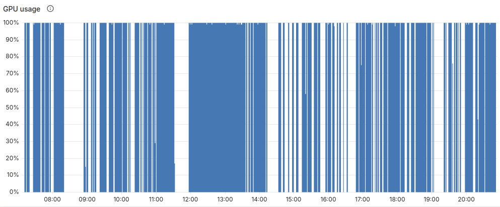

The MVP of our automated review system is now monitoring every repository in the main project. In its first month 75% of PRs received feedback within 8 minutes. Reviews come from a self-hosted model with transparent fallback to hosted providers (e.g. Anthropic).

Early this year, the productivity boost of LLMs was evident enough that our team started questioning fundamental aspects of our software delivery processes. Code reviews were the first item of concern because the cost / benefit tradeoff had broken apart. The opportunity cost was expanding: time spent reviewing is not spent planning, design, implementation or housekeeping, and we were becoming more productive in all those tasks. But the benefits we got in return from peer reviewing code (knowledge transfer, consistency, collective ownership) seemed to dissolve as engineers tended to delegate to their coding harness.

This left us with two problems: implementing a system that could review whatever amount of code we threw at it without compromising quality, and finding alternatives to make up for the cognitive drawbacks of not reading most of the code.

At a high level, the review system is designed as a boring programmatic scaffold around special purpose agents that participate in the review workflow. This rests on two key design principles.

## Determinism when possible, inference when necessary

A good part of the work involves exchanges of structured data among systems via API calls and database queries that are repetitive, predictable, virtually free to implement once in a programming language, and inexpensive to run on CPUs. The only part that requires an LLM is understanding diffs in the context of a large codebase, engineering practices, specs, documentation and so on.

A general purpose AI agent could do both jobs on its own, but not without drawbacks. Processing REST API requests isn’t a great use of token budget. But most importantly, it overlooks the non-deterministic nature of LLMs, barely noticeable in a single session but important when repetition compounds its effects.

For a system that processes a continuous stream of work, behaviour across PRs must remain consistent and predictable. That is easier to achieve when prompts focus on a specific task, rather than aspiring to create a natural-language spec of the entire system end to end. (Evidence: hours trying to convince agents to obey trivial instructions reliably, like outputting a one-line json template that downstream systems parse for audit purposes, POSTing comments in the right place without messing up the data payload, not repeating feedback already given in the previous review cycle. More than half of the prompts are concerned with these aspects.)

Would a frontier model pull it off? Probably. But again, burning tokens, and increasing verification overhead to control non deterministic behaviour doesn’t make much sense when we can get the same outcome with Python programs and a cheaper model.

## Incremental integration, not replacement

PRs were already grounds for interactions among multiple actors: humans, coding agents, traditional automation. Releasing unpolished agents into that ecosystem escalated quickly to a bull-in-a-china-shop situation. Once, an engineer reported that he “had lost control of this PR”, which was exactly the opposite of our goal. We scaled back specialist agents precisely because the interactions among them, engineers, and Claude coding sessions became sometimes chaotic. It was too much, too soon.

The review system had to blend in and increase team efficiency without disruption. Thus, a fair amount of work went into observing interaction dynamics to nudge the system in the right direction. Nitpicker had a tendency to overload engineers with feedback, spraying PRs with treatises on their thought process, reflections on SonarCloud’s findings, or chronicling earlier rounds of review. That had to be prompted away. It paid off to keep agent prompts lean and focused on a single purpose for behaviours that couldn’t be programmed, and move the rest to the harness.

As the review agents earn trust, human contributions have become less about raw eyeball time, more about high level judgement. Engineers delegate reading code to agents, and intervene to analyze review reports, dig in the code when necessary, and make judgement calls. This includes arbitrating on the otherwise fascinating debates between Nitpicker, our main review agent, and Claude in comment threads. Human workflows and muscle memory adapted, dropping inefficient habits like copy pasting urls and feedback to Claude, or triggering a review from Claude on a laptop (that $coworker had also done 2 min. ago).

## System architecture



The system has four basic building blocks. An `observer` receives events from GitHub and stores a view of every PR in the project. A `loop` inspects the view and issues requests to the relevant agent(s). A `scheduler` dispatches work to agents and collects audits. The UI provides visibility and some control functions so anyone can pause any component, inspect audit logs, get a personal or team-wide view of work in flight, etc.

To run agents the `scheduler` manages a fixed number of runners that get warmed up with ephemeral, agent-specific credentials, and a checkout of the relevant PR branch. It then assembles a prompt and pipes it to a fresh `opencode` or `claude` session (we’ll see below why we don’t persist sessions across reviews of the same PR), dealing with retries, timeouts, and collecting audit information after runs. Scaling the scheduler and runtime is likely to be a future area of development, with something like [Agent Executor](https://github.com/google/ax/) in our sights.

## The inference provider

We run a self-hosted inference provider based on vLLM. This decision was based on two factors:

* Frontier model reviews are expensive. Anthropic [estimates](https://claude.com/resources/articles/code-review) $15 to $25 per code review. We found them cheaper when driven from Claude Code and older models, but still in the ballpark of our total cost to implement the average feature. We’d very much prefer to see those tokens in the engineers’ budget. Cheaper review providers exist, but come at the expense of a fragmented ecosystem, data protection concerns, and so on.
* Our product is a platform to manage on-prem GPU infrastructure and AI workloads, including an Inference Provider based on [vLLM](https://github.com/vllm-project/vllm). And we have a dev/test lab with mid-tier GPUs (e.g. A100, RTX PRO 6000) which were far from 100% utilisation.

By using our own staging environment we squeeze more value from GPUs that we already had to buy anyway, as well as dogfood our own product, and generate realistic workloads that inform product development. Availability problems during operations on the lab can be mitigated thanks to the embedded fallback to hosted models (e.g. Claude).

We use [Qwen3.8-27B-NVFP4](https://huggingface.co/unsloth/Qwen3.8-27B-NVFP4). A smaller model comes with some challenges, especially for engineers used to frontier model reviews. They have less tolerance for poorly written prompts and are more sensitive to large context windows. But both became a positive incentive to define goals and criteria clearly or keep ADRs, documentation and other materials information-dense. Context constraints influenced our decision to not persist the same session across all reviews of the same PR, which as we’ll see may be a negative factor.

<em>Utilisation of a single RTX PRO 6000 over a working day</em>

## What reviews catch (and don’t)

The model catches functional and non functional issues in PRs reliably, even with larger (1-2k line) diffs. Reviews detect incomplete assumptions, testing gaps not merely due to coverage, inconsistencies between the rationale or intent of a change and its actual implementation. Disagreements with Claude appear, but tend to resolve in favour of Nitpicker.

Agents analyze each PR in its own context but also other repositories in the project. They flag consistently:

* Corner cases from n-th order side effects of a change, including backwards compatibility with dependencies in other repositories that would be discovered at rollout time during upgrades, performance implications (e.g. by using a different method in a 3rd party library), and others.
* Warnings to PR authors when an unrelated, in flight PR in the same or other repos might cause disruption upgrading environments, with proposals on the best way to coordinate changes or, better, avoid them.
* Blind spots in tests, even when related to small differences between environments.
* Inconsistencies with ADRs, PRDs, specs or documentation, and idiomatic nuances in English / Japanese translations.

We still experiment with agents to address feedback automatically, and specialists for security reviews and other purposes.

On the downside, behaviour after successive review cycles can be annoying: agents tend to produce redundant feedback on the same PR, and sometimes try too hard to find more. This is the likely tradeoff from not persisting a single session for the full PR, which we do to avoid inflating contexts. Our hypothesis is that keeping contexts small helps smaller models perform better on individual review rounds, but their limits against frontier models will be more prominent maintaining quality over long-running tasks.

## Measuring quality and driving improvements

Complaints received from engineers within minutes of any service interruption have been a valuable indicator of success, but our next steps will focus on implementing more structured quality measures to guide improvements and new features.

For now, the choice to KISS the storage as a single database proved helpful to whip up metrics almost on demand into an internal dashboard. Cross checking the local view of GitHub data, internal state and logs of agent requests with execution logs gave us metrics like:

* Feedback acceptance rate, as a critical measure of whether agent feedback is relevant and actionable. It sits at ~87%.
* Runner utilisation limits the volume of reviews. GPU capacity (each RTX PRO 6000 can serve ~5-6 concurrent review agents) is a key constraint, but not the only one.
* Run time breakdown. With a p50 review time of 4m 34s, only 1m 50s are spent waiting for the model. After dealing with low hanging fruit (e.g. spot common tools in logs and preinstall them so agents don’t need to), the plumbing still has room for improvement before jumping to the inference service (this is where our interest for [Agent Executor](https://github.com/google/ax) comes from).
* Time to feedback. Beyond the obvious application, it’s been helpful to settle meta-discussions about development practices. Engineers observed that coding agents lead to larger diffs and wondered if that slowed down automated reviews (answer at the time: not meaningfully, but this is pending closer analysis with more data.)

Still a short term priority is to move from organic and after-the-fact instrumentation to a more systematic approach to defining and evaluating performance indicators. This includes low level metrics, but also higher level analysis of the system. For example, we want an agent analyzing the interactions on PRs post-merge to detect and feed refinements back into `AGENTS.md` of individual repositories to be considered by coding agents, as well as improving review prompts, ADRs, etc.

## Investing the attention dividend

Engineers have shifted focus naturally to higher level topics that include most of our original concerns. If we don’t review code, what are the best alternatives to ensure knowledge transfer, consistency, collective ownership, and quality standards? If we multiply throughput, how do we scale our technical infrastructure?

Code reviews will change, but they remain an excellent place to instrument the development process, providing critical information to understand the impact of AI in our work, and inform the changes we introduce in our technical infrastructure and process. Work that’s even more important in an industrial mode of production.
