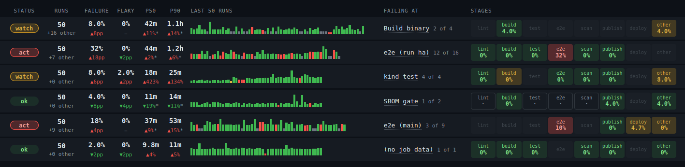

Several people in my network messaged me about the piece on [automating
our code
reviews](https://varoa.net/2026/11/03/we-review-every-pr-with-a-27b-model-on-self-hosted-infra.html)
with a common theme: "<em>my team has reached similar conclusions, but
doesn’t feel confident enough to merge PRs only with automated reviews,
or ready to mitigate the risks of understanding a complex system less
and less</em>”.

The shape of this argument is familiar: I’ve heard it applied to cloud
computing, continuous delivery, automated testing, deploys on Fridays,
once reckless fantasies that now sit in the canon. We may not know what
exactly is on the other side of the industrialization of software, but
we do have a decent idea of how we can navigate the transformation.

The basic principle is that obstacles and risks are real, but we don’t
need to treat them as facts of nature. Here was [Charity
Majors](https://charity.wtf/p/friday-deploy-freezes-are-exactly-like-murdering-puppies)
addressing the “don’t deploy on Fridays” crowd back in 2019:

> Saying “don’t push to production” is a code smell. [….] If you’re used to hearing it and saying it on a weekly basis, *you are afraid of your deploys and you should fix **that**.*

Worried about merging PRs on automated reviews alone? You should fix
*that*. Worried about engineers losing touch with a complex system if
they don’t read every line of code? You should fix *that*. If you have
determined that leveraging AI to produce more software faster benefits
your business, then every risk and every obstacle turns into a target to
remove.

## Outgrowing our test strategy

The usual first concern with merging on automated reviews is breaking
things, and the obvious fix is automated tests. Ours were already in
good shape, but we knew that even if the probability of a buggy PR
sneaking through was low, multiplying by a higher amount of changes
guarantees trouble.

“You should fix *that*” became then about tightening every safety net
even further until the `P(defect)` per PR shrank. But a more effective
quality filter came with tradeoffs. Our product provides multi tenant
GPU infrastructure automation, tests are complex and we don’t have the
luxury of being able to deploy continuously or use feature flags and
canaries. The PR gates and post-merge checks we rely on became slow (20m
for integration tests, 1h for e2e) and resource intensive (e2e tests
need a realistic virtual environment provisioned inside medium sized
VMs with 16 vCPUs and 64GB).

Queuing theory puts three basic knobs to deal with saturation at our
disposal. We could add workers, reduce service times, or lower the
arrival rate. But neither were straightforward to apply.

Adding (or up-scaling) workers is problematic because test
infrastructure costs scale at an even worse ratio than code flows: each
PR needs multiple e2e test runs to cover review rounds (median = 2, mean
= 7.5). Service times, specially on the heaviest suites, are bound by
the OS, network interactions, k3s reconciliation cycles.

That leaves the arrival rate. We obviously don’t want fewer PRs. But
having fewer test runs per PR was attractive. We already knew that test
runs did a lot of redundant work (the same suite runs multiple times in
each PR, on laptops or cloud agents, then in main ...). Our worry was
that choosing which tests are relevant for each run isn’t obvious, and a
mistake can lead to serious disruption downstream. We were not ready to
start relaxing checks.

So we set out to fix *that*.

We instrumented test runs in main to get a detailed baseline of success rates. This enabled relaxing PR gates in a controlled fashion. The dashboard below shows test workflows running in `main` in some repositories.

Verification workflows in `main` take the role of a back-pressure valve.
The 2nd or 5th workflows signal that we should hold experimentation
upstream, and focus on getting `main` stable. The 4th and 6th ones are
stable enough to relax gates and remove some tests from the PR gates. If
that lets defects slip through, we can react to failures in `main` with
automated reverts, and eventually reinstate tests when recurrent
failures prove that they are relevant PR gates. This is the current item
in our roadmap.

What makes transitions like this one harder is that the solutions often
take you to unfamiliar places.

At the moment, we run the full test suite continuously on the `HEAD` of
`main`, implicitly treating the branch as a “verification queue”. Every
test run drains all changes pushed while the previous test run executed,
and verifies them in batch. As the rate of changes merged to main
increases, this strategy won’t be viable: batches will grow too large
making failures per batch more likely and disruptive.

This will force us to apply to post-merge verification the same
strategies we now apply to PRs. Each run should focus on tests relevant
to the change, sampling test cases outside of the relevant set for
control. We will need strong instrumentation, and automated feedback
loops that react quickly to failures without blocking the pipeline.

As the ability to weed out defects improves, bottlenecks move further
downstream. It’s plausible that PR gates become thin or even disappear.
Coding agents in laptops or cloud are already able to run builds and
tests. They are increasingly able to ship correct code making
regressions in `main` unlikely. When they do happen, automated reverts
or fixes minimize disruption. Each of those steps has reasonable buts
and what-ifs, but all admit the same reply: “you should fix *that*”.

Our industry used the term “pipeline” in software delivery for a long
time. But the reality is that most didn’t deserve the name. Industrial
pipelines are robust, highly standardized and well structured systems
that regulate high volume flows. Our pipelines build and run tests but
rely on manual hand holding for any disruption. We lacked consistent
conventions across workflows (being traditionally reluctant to take away
autonomy from engineers) which complicate getting comparable metrics
across the system.

Following an industrial mode of production for software will conflict
with the assumptions and practises that made us feel comfortable. We
should fix *that*.
